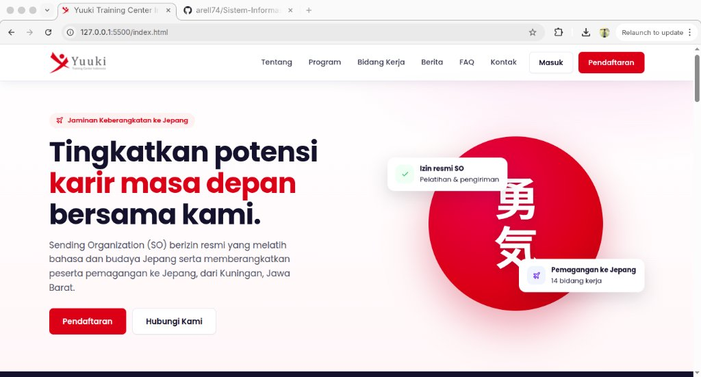
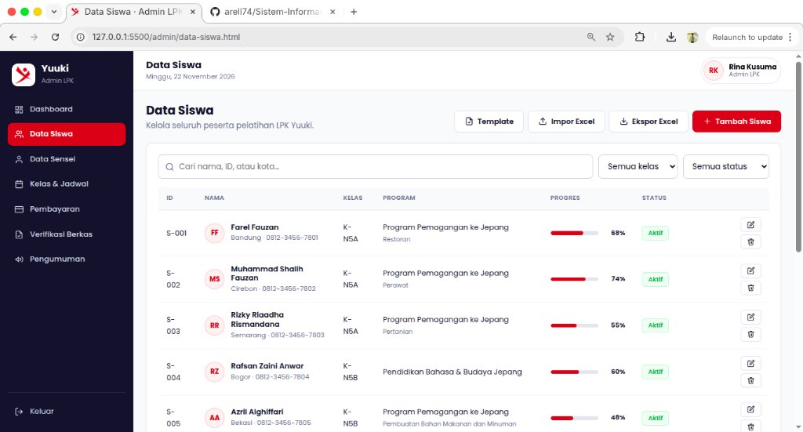
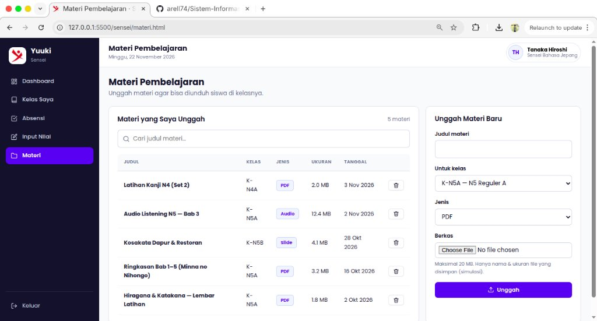
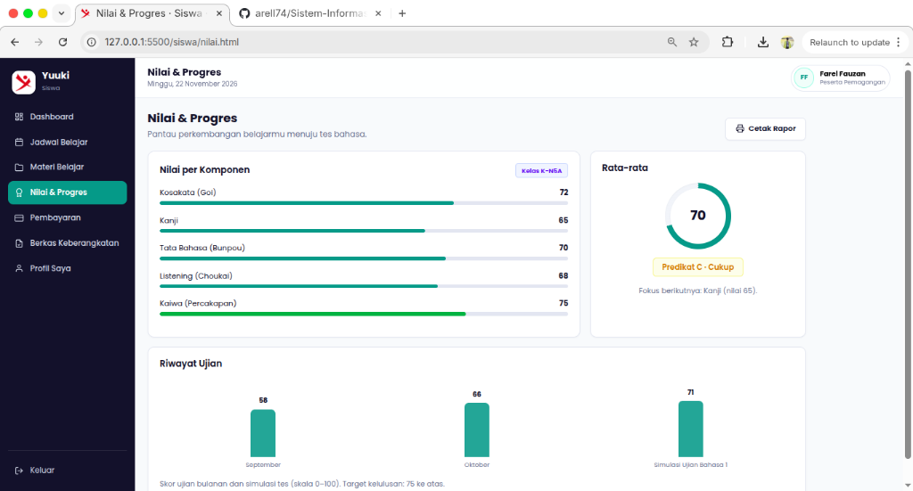
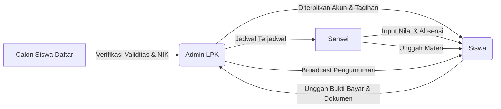

<div align="center">

  

  <!-- # Yuuki Portal -->
  ### Sistem Informasi Manajemen LPK Yuuki Training Center Indonesia
  *Sistem Pelatihan, Manajemen Data Peserta, dan Persiapan Pemberangkatan Kerja ke Jepang*

  <p align="center">
    <a href="https://developer.mozilla.org/en-US/docs/Web/HTML"></a>
    <a href="https://developer.mozilla.org/en-US/docs/Web/CSS"></a>
    <a href="https://developer.mozilla.org/en-US/docs/Web/JavaScript"></a>
    <a href="https://sheetjs.com/"></a>
    <a href="manifest.json"></a>
    <a href="LICENSE"></a>
    <a href="#"></a>
  </p>

  <p align="center">
    <b>送り出し機関 勇気研修センターインドネシア</b><br>
    Studi kasus Sending Organization (SO) LPK Yuuki — Kuningan, Jawa Barat
  </p>

</div>

---

## 📌 Ringkasan Proyek

**Yuuki Portal** adalah aplikasi web sistem informasi akademik dan administrasi terpadu yang dirancang khusus untuk memfasilitasi operasional **Sending Organization (SO) LPK Yuuki**. Sistem ini melayani pengelolaan pelatihan bahasa dan budaya Jepang, verifikasi berkas, pemantauan progres evaluasi siswa, hingga alur persiapan keberangkatan peserta pemagangan ke Jepang.

Aplikasi ini dikembangkan menggunakan arsitektur **Pure Vanilla Web (HTML5, CSS3 modern, dan ES6 JavaScript)** tanpa *framework* berat, serta memanfaatkan `localStorage` browser yang reaktif dan aman sebagai *persistent mock database*.

> [!NOTE]  
> **Disclaimer:** Repositori ini merupakan proyek akademik mata kuliah **Web Desain**. Identitas kelembagaan mengacu pada profil resmi LPK Yuuki Training Center Indonesia. Seluruh data pengguna, riwayat pembayaran, nilai, dan dokumen keberangkatan di dalam sistem adalah data contoh (*dummy simulation*).

---

## 📸 Pratinjau Antarmuka (Preview)

Berikut adalah beberapa tampilan utama antarmuka sistem pada berbagai portal pengguna:

### 1. Halaman Beranda Publik (Landing Page)
> Portal informasi resmi bagi masyarakat, mitra kerja, dan calon siswa mengenai profil SO, 14 bidang kerja pemagangan, alur pelatihan, serta formulir registrasi online.

<p align="center">
  
</p>

---

### 2. Panel Admin — Manajemen Data Siswa & Integrasi Excel
> Dashboard komprehensif bagi Administrator LPK untuk mengelola pendaftar, monitoring progres persiapan siswa, pencarian cepat, serta impor & ekspor data via spreadsheet (SheetJS).

<p align="center">
  
</p>

---

### 3. Panel Sensei — Distribusi Materi Pembelajaran
> Ruang kerja instruktur/Sensei untuk mengunggah materi pelajaran (PDF, audio choukai, slide presentasi), memantau absensi kelas, dan mengelola bank materi ajar.

<p align="center">
  
</p>

---

### 4. Panel Siswa — Pantau Nilai & Progres Belajar
> Dashboard personal siswa untuk memantau performa 5 komponen bahasa (Goi, Kanji, Bunpou, Choukai, Kaiwa), grafik riwayat ujian berkala, dan status kesiapan tes resmi (JLPT/NAT-TEST).

<p align="center">
  
</p>

---

## 👥 Aktor & Hak Akses (Multi-Role System)

Sistem dirancang dengan pemisahan wewenang yang tegas (*Role-Based Access Control*) yang dijaga oleh modul keamanan `js/guard.js`:

| Peran | Ruang Lingkup & Wewenang Utama | Tema Aksen |
| :--- | :--- | :---: |
| **🌐 Publik / Calon Siswa** | Mengakses informasi program, 14 bidang kerja, profil sensei, FAQ, serta mengajukan formulir pendaftaran siswa baru secara online. | Neutral Red |
| **🛡️ Admin LPK** | Mengelola verifikasi kelayakan pendaftar baru, CRUD siswa & sensei, jadwal & ruang belajar (dengan validasi bentrok otomatis), validasi pembayaran & kwitansi, verifikasi dokumen legal/paspor, serta broadcast pengumuman. | Crimson Red (`#C8102E`) |
| **📚 Sensei (Pengajar)** | Mengelola kelas yang diampu, mengisi kehadiran harian siswa, menginput nilai evaluasi (otomatis menghitung rata-rata & predikat), dan mendistribusikan materi belajar. | Royal Blue (`#3B82F6`) |
| **🎓 Siswa** | Memantau progres kesiapan kerja, grafik nilai & riwayat ujian, jadwal sesi belajar, mengunduh modul, unggah bukti bayar & kwitansi, serta unggah dokumen paspor/visa. | Emerald Green (`#0D9488`) |

### 🔄 Alur Integrasi Antar Aktor



---

## ⚡ Fitur Unggulan

### 🔍 1. Sistem Deteksi & Verifikasi Pendaftar Cerdas (Admin)
Dashboard admin dilengkapi dengan kalkulasi kelayakan otomatis untuk menyaring pendaftar:
- Validasi format 16-digit NIK, kode wilayah provinsi, dan sinkronisasi tanggal lahir serta gender.
- Validasi kewajaran data (deteksi pengetikan acak / keyboard mash, deteksi disposable email).
- Status rekomendasi otomatis: **Meyakinkan**, **Perlu dicek**, atau **Mencurigakan**.
- Alur tindakan langsung: integrasi kontak via WhatsApp resmi, pencatatan verifikator, serta persetujuan berkas.

### 📊 2. Integrasi Impor & Ekspor Spreadsheet (SheetJS)
- Menyediakan template unduhan Excel standar `.xlsx`.
- Validasi baris demi baris secara interaktif saat impor: baris valid masuk ke database, baris keliru atau duplikat diberi penanda alasan yang transparan.
- Ekspor data siswa dinamis mengikuti filter dan pencarian aktif.

### ⏱️ 3. Penjadwalan Cerdas Anti-Bentrok
- Deteksi konflik otomatis: sistem menolak penyimpanan jadwal bila sensei atau ruangan yang dipilih telah terisi pada hari dan rentang jam yang sama.

### 📈 4. Visualisasi & Evaluasi Nilai Komprehensif
- Siswa dan sensei disajikan visualisasi grafik batang dan ring meter nilai berbasis CSS murni.
- Perhitungan otomatis rata-rata 5 kompetensi (Goi, Kanji, Bunpou, Choukai, Kaiwa) beserta predikat dan rekomendasi fokus belajar.

### 📱 5. Progressive Web App (PWA) & Dukungan Mode Offline
- **Instalasi ke Layar Utama:** Siswa dan guru dapat memasang Yuuki Portal langsung ke layar utama smartphone (Android & iOS) selayaknya aplikasi native tanpa melalui toko aplikasi.
- **Service Worker Caching (`sw.js`):** Menggunakan strategi *Stale-While-Revalidate* dan *Network-First fallback* yang memungkinkan akses jadwal, materi, dan flashcard kosakata bahkan saat berada di area tanpa koneksi internet (*offline mode*).
- **Indikator Jaringan & Install Prompt:** Deteksi status online/offline otomatis dengan notifikasi interaktif serta tombol pasang cepat pada menu dashboard.

---

## 🔑 Akun Demo

Sistem menyediakan akun siap pakai untuk mengeksplorasi seluruh hak akses portal:

| Peran | Email | Kata Sandi | Halaman Utama |
| :--- | :--- | :--- | :--- |
| **Administrator** | `admin@yuuki.test` | `admin123` | `admin/dashboard.html` |
| **Sensei (Guru)** | `sensei@yuuki.test` | `sensei123` | `sensei/dashboard.html` |
| **Siswa** | `siswa@yuuki.test` | `siswa123` | `siswa/dashboard.html` |

> [!TIP]  
> Pada pojok kanan atas menu pengguna dashboard, tersedia tombol **Reset Data** untuk mengembalikan seluruh modifikasi data di browser ke kondisi awal (*seed data* bawaan).

---

## 📂 Struktur Repositori

```text
yuuki-portal/
├── index.html                  # Landing page publik (Company Profile)
├── pendaftaran.html            # Formulir registrasi calon siswa baru
├── login.html                  # Halaman otentikasi login multi-role
├── css/
│   ├── style.css               # Desain pondasi, token variabel, tombol, & form
│   ├── public.css              # Layout & styling halaman publik
│   ├── dashboard.css           # Shell layout dashboard, navigasi, topbar, & sidebar
│   ├── admin.css               # Identitas warna aksen Admin (Red)
│   ├── sensei.css              # Identitas warna aksen Sensei (Blue/Indigo)
│   └── siswa.css               # Identitas warna aksen Siswa (Teal/Emerald)
├── js/
│   ├── data.js                 # Seed mock data awal (pengganti database server)
│   ├── app.js                  # Core utility: Store (localStorage), Auth, Form, & UI
│   ├── guard.js                # Penjaga otorisasi rute per sesi peran
│   ├── profil.js               # Logika manajemen akun & ubah profil terpadu
│   ├── admin/                  # Modul spesifik Admin (siswa, sensei, jadwal, bayar, dll.)
│   ├── sensei/                 # Modul spesifik Sensei (absensi, nilai, materi, kelas)
│   └── siswa/                  # Modul spesifik Siswa (progres, dokumen, jadwal, bayar)
├── admin/                      # Halaman HTML antarmuka Admin (8 view)
├── sensei/                     # Halaman HTML antarmuka Sensei (6 view)
├── siswa/                      # Halaman HTML antarmuka Siswa (7 view)
└── img/                        # Aset grafis, logo brand resmi, & screenshot
```

---

## 💻 Panduan Penggunaan & Instalasi

Aplikasi ini tidak memerlukan instalasi backend, build tools (Node/Webpack), ataupun konfigurasi database:

1. **Clone repositori ini:**
   ```bash
   git clone https://github.com/arell74/yuuki-go.git
   cd yuuki-go
   ```

2. **Jalankan aplikasi:**
   - **Metode 1 (Rekomendasi):** Buka dengan ekstensi **Live Server** di Visual Studio Code pada berkas `index.html`.
   - **Metode 2:** Buka langsung berkas `index.html` menggunakan browser modern (Chrome, Edge, Firefox, Safari).

---

## 🛠️ Standar Kode & Desain

- **Desain UI/UX:** Tipografi modern menggunakan kombinasi *Poppins* dan *Noto Sans JP*, visual kontras yang ramah aksesibilitas (*clean layout*, tanpa efek berlebih), dan sepenuhnya adaptif (*mobile-friendly sidebar drawer*).
- **Format Commit:** Repositori ini menerapkan konvensi [Conventional Commits](https://www.conventionalcommits.org/) (`feat:`, `fix:`, `style:`, `refactor:`, `docs:`).

---

## 📄 Lisensi

Didistribusikan di bawah lisensi **MIT**. Silakan lihat berkas [LICENSE](LICENSE) untuk ketentuan lebih lengkap.

<div align="center">
  <sub>Dibangun dengan dedikasi untuk mendukung kemajuan pendidikan dan pemagangan tenaga kerja Indonesia ke Jepang. 🇮🇩 🤝 🇯🇵</sub>
</div>
